<div align="center">
  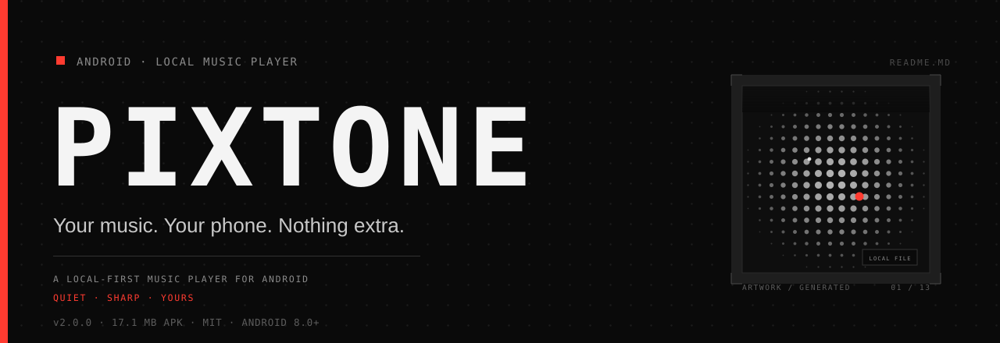
</div>

<p align="center">
  
  
  
  
  
  
  
</p>

<p align="center">
  <b>A local-first music player for Android — quiet, sharp, and yours.</b><br>
  <sub>No account · no cloud · no ads · no analytics</sub>
</p>

PIXTONE plays the music stored on your device. Just a folder, a queue and an interface built around dots, segments and pixels. Nothing is uploaded anywhere: network access is used only for optional lyrics, cover lookup and the online catalog.

<p align="center">
  <code>59 KOTLIN FILES</code> · <code>16,369 LINES</code> · <code>6 LANGUAGES</code> · <code>0 TRACKERS</code> · <code>17.1 MB APK</code>
</p>

<p align="center">
  <a href="https://github.com/JameSanderlanding/PIXTONE/releases/latest"></a>
</p>

## 01 — Screenshots

All screenshots show the English interface with a generated demo library. Track titles and cover art are original and created for this project; the lyrics shown are from the public-domain hymn "Amazing Grace".

<table>
  <tr>
    <td align="center" width="33%">
      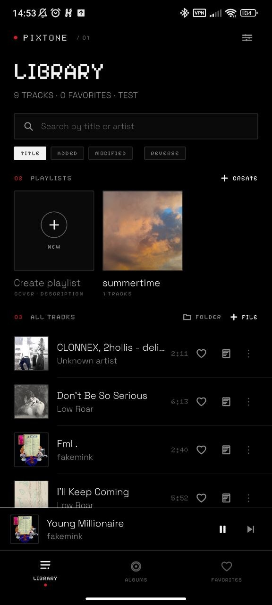<br>
      <sub><b>01</b> · LIBRARY</sub>
    </td>
    <td align="center" width="33%">
      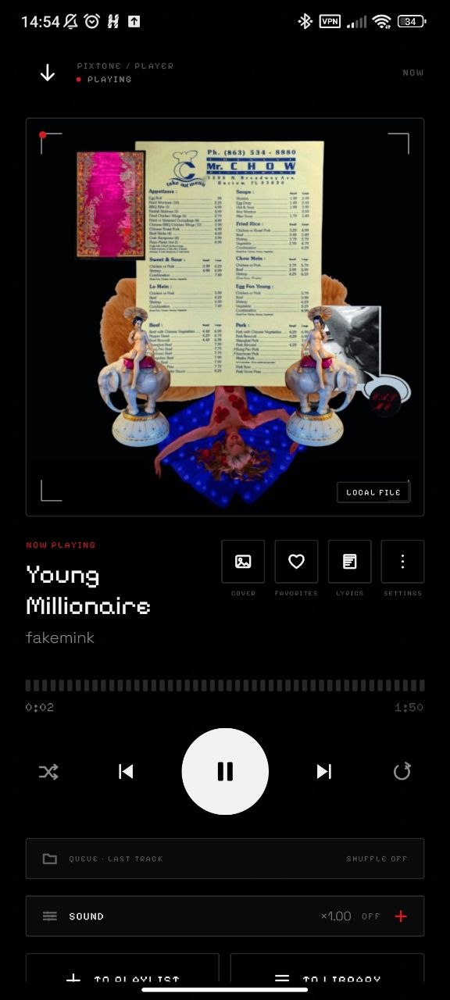<br>
      <sub><b>02</b> · PLAYER</sub>
    </td>
    <td align="center" width="33%">
      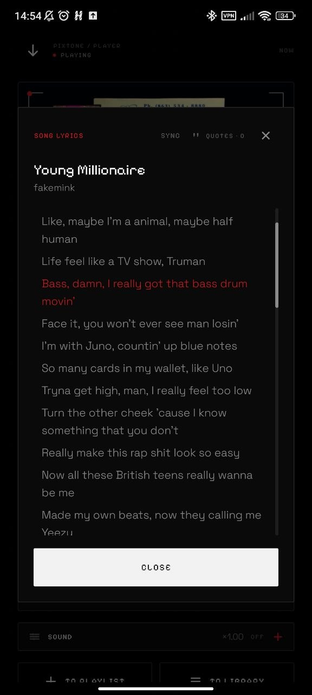<br>
      <sub><b>03</b> · LYRICS</sub>
    </td>
  </tr>
  <tr>
    <td align="center" width="33%">
      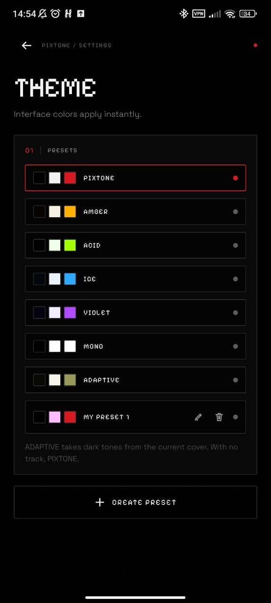<br>
      <sub><b>04</b> · THEMES</sub>
    </td>
    <td align="center" width="33%">
      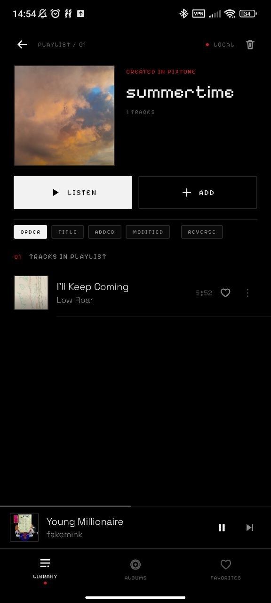<br>
      <sub><b>05</b> · PLAYLIST</sub>
    </td>
    <td align="center" width="33%">
      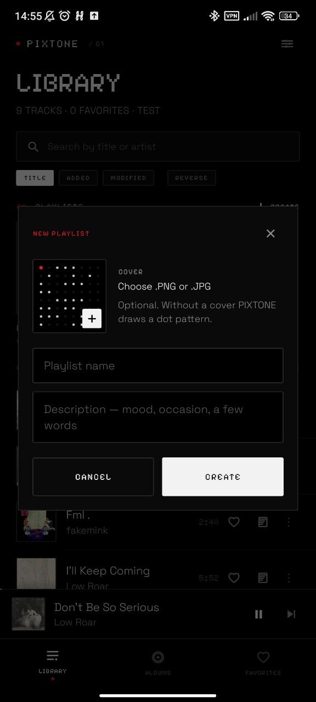<br>
      <sub><b>06</b> · CREATE PLAYLIST</sub>
    </td>
  </tr>
</table>

<details>
<summary>More screenshots</summary>

<br>

<table>
  <tr>
    <td align="center" width="33%">
      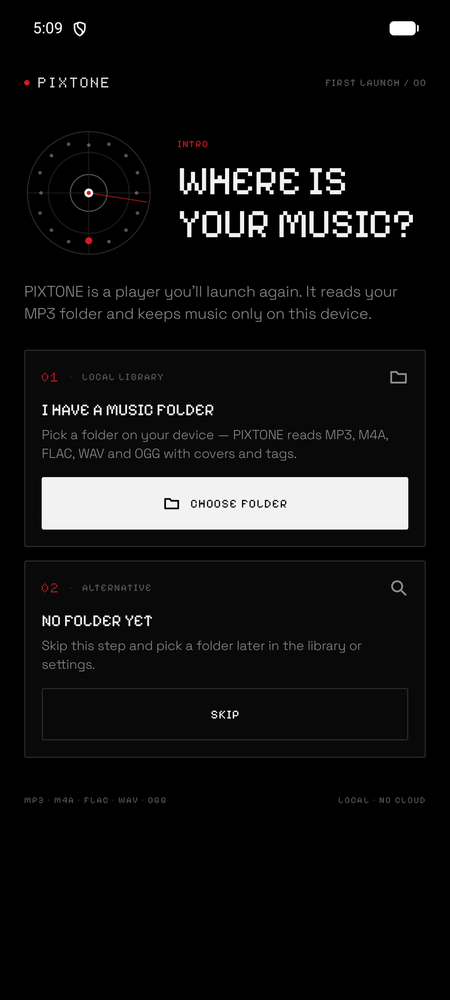<br>
      <sub><b>07</b> · ONBOARDING</sub>
    </td>
    <td align="center" width="33%">
      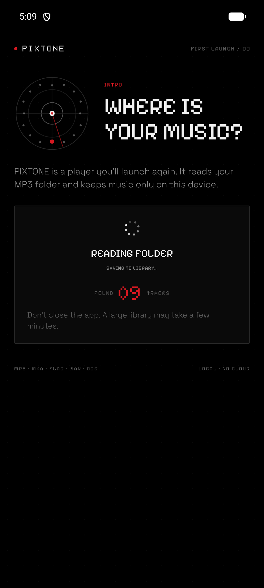<br>
      <sub><b>08</b> · SCANNING</sub>
    </td>
    <td align="center" width="33%">
      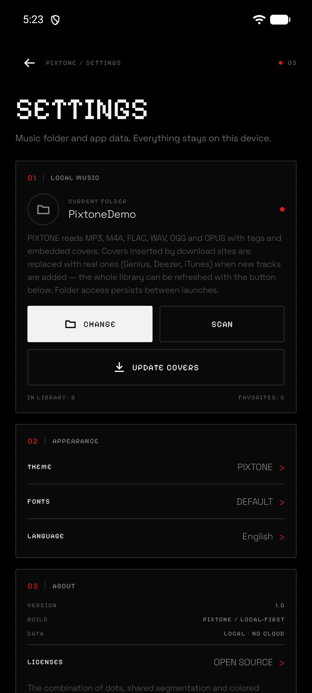<br>
      <sub><b>09</b> · SETTINGS</sub>
    </td>
  </tr>
  <tr>
    <td align="center" width="33%">
      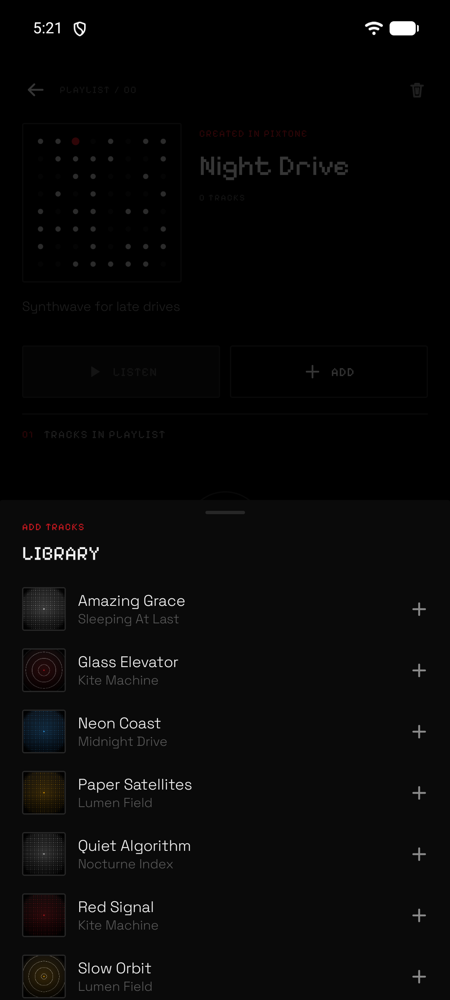<br>
      <sub><b>10</b> · ADD TRACKS</sub>
    </td>
    <td align="center" width="33%">
      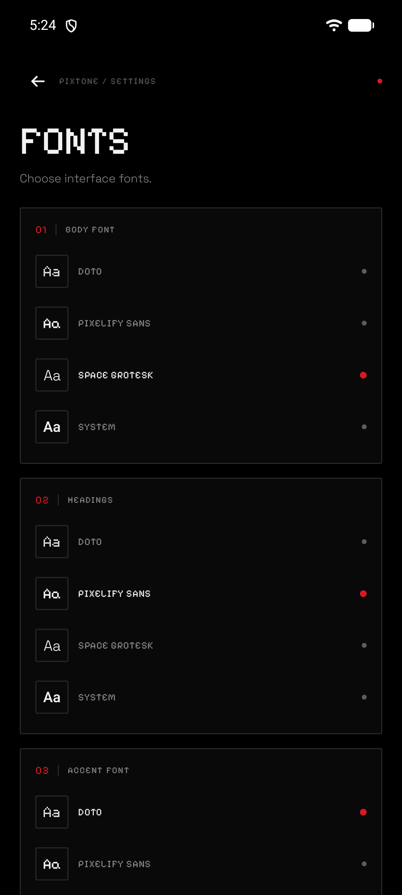<br>
      <sub><b>11</b> · FONTS</sub>
    </td>
    <td align="center" width="33%">
      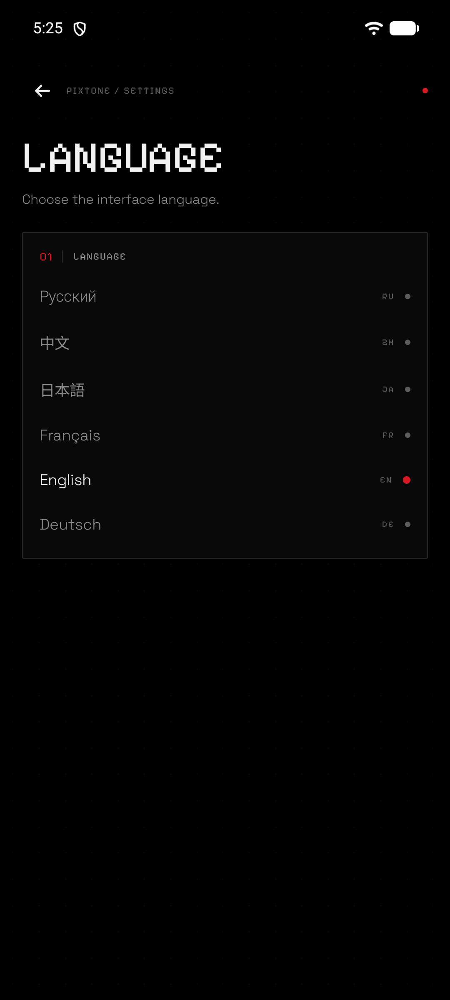<br>
      <sub><b>12</b> · LANGUAGES</sub>
    </td>
  </tr>
  <tr>
    <td align="center" width="33%">
      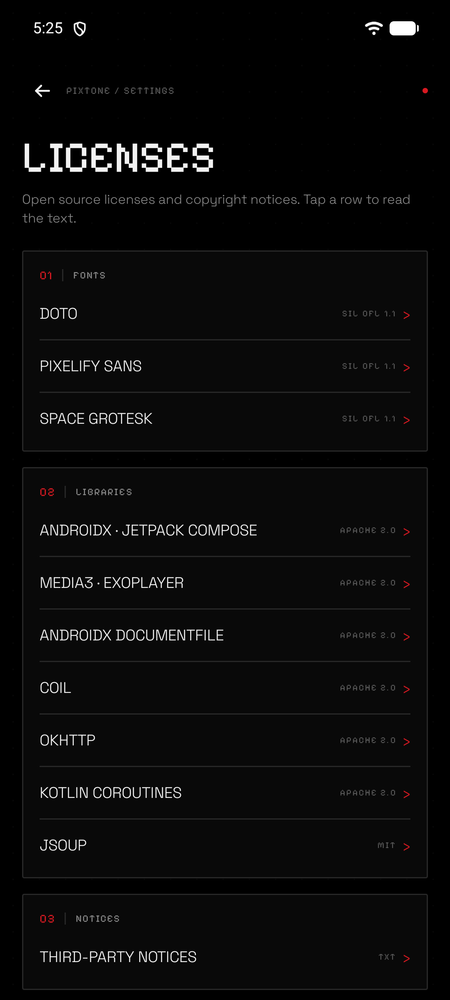<br>
      <sub><b>13</b> · LICENSES</sub>
    </td>
    <td align="center" width="33%"></td>
    <td align="center" width="33%"></td>
  </tr>
</table>

</details>

## 02 — Features

| Feature | Details |
|---|---|
| **Local-first library** | Music stays on device |
| **Online catalog** | JioSaavn search and streaming |
| **Folder scanning** | MP3, FLAC, OGG, AAC |
| **Background playback** | Notification and Bluetooth |
| **Sound tuning** | EQ, bass, reverb, speed, custom presets |
| **Playlists and favorites** | Offline SQLite storage |
| **Track search and edit** | Search, edit, override |
| **Albums** | Grouped by tags |
| **Sorting** | Five modes, persistent |
| **Multi-select** | Bulk select, delete |
| **Own images** | Covers from gallery |
| **Sticky headers** | Search folds away |
| **Lyrics** | Synced LRC, quotes, quote images |
| **Smart cover art** | Genius, Deezer, iTunes |
| **Themes** | Six presets, custom palettes |
| **Custom typography** | Four fonts, three roles |
| **Six languages** | Switch on the fly |
| **Pixel dissolve toasts** | Tap to dismiss |
| **Lightweight and private** | No trackers, no ads |

## 03 — Tech stack

| Layer | Technology |
|---|---|
| **Language** | Kotlin 2.2 |
| **UI** | Jetpack Compose, Material 3, custom design system |
| **Playback** | AndroidX Media3 (ExoPlayer), MediaSessionService, system audio effects and a custom reverb AudioProcessor |
| **Async** | Kotlin Coroutines, StateFlow / SharedFlow |
| **Images** | Coil |
| **Networking** | OkHttp, org.json, Jsoup |
| **Storage** | SQLiteOpenHelper, SharedPreferences, Storage Access Framework |
| **Architecture** | Single-Activity, state-driven UI, ViewModel + repository layer, manual DI (`AppContainer`) |
| **Build** | Gradle 9.6, Android Gradle Plugin 9.4.1, JDK 21 |
| **SDK** | minSdk 26, targetSdk 37, compileSdk 37 |

## 04 — Architecture

```text
MainActivity
  └── GlyphTheme (colors + typography from user settings)
        └── GlyphRoot (state-driven navigation)
              ├── LibraryScreen / FavoritesScreen
              ├── OnlineScreen (JioSaavn catalog)
              ├── PlayerOverlay (with the sound panel)
              ├── SettingsScreen (theme, fonts, language, licenses)
              └── MessageHost (queued toasts)

MainViewModel ── MusicRepository ── GlyphDb (SQLite)
      ├── MusicScanner / ArtworkStore
      ├── LyricsRepository ── LRCLIB / lyrics.ovh / Genius
      ├── CoverRepository  ── Genius / Deezer / iTunes
      ├── JioSaavnClient   ── online search and streaming
      └── PlayerConnection ── PlaybackService (Media3)
```

The app has no backend and no network dependency for local playback. Network access is used only for optional lyrics, cover lookup and the online catalog.

## 05 — Project structure

```text
app/src/main/java/com/vova/glyph/
├── MainActivity.kt          # single entry point
├── MainViewModel.kt         # app state and use cases
├── GlyphApp.kt              # application + container bootstrap
├── AppContainer.kt          # manual dependency injection
├── data/                    # database, scanner, repositories, prefs
├── playback/                # ExoPlayer connection and media session
├── i18n/                    # translations for six languages
└── ui/
    ├── GlyphRoot.kt         # root navigation and messages
    ├── theme/               # palette, presets, fonts, typography
    ├── components/          # design system and reusable UI
    └── screens/             # library, player, settings, onboarding
```

## 06 — Build

Requirements:

- JDK 21
- Android SDK with API 37
- Android Studio or the command line

```bash
git clone https://github.com/JameSanderlanding/PIXTONE.git
cd PIXTONE
./gradlew assembleDebug
```

The debug APK is produced at:

```text
app/build/outputs/apk/debug/Pixton 2.0.0.apk
```

`local.properties` with your own `sdk.dir` is ignored by Git.

## 07 — Third-party licenses

Fonts — Doto, Pixelify Sans, Space Grotesk — are licensed under the **SIL Open Font License 1.1**.

Libraries are licensed under **Apache License 2.0** (AndroidX, Compose, Media3, Coil, OkHttp, Kotlin Coroutines) and **MIT** (Jsoup).

Full license texts are bundled in `app/src/main/assets/licenses/` and available inside the app under **Settings → Licenses**.

## 08 — Disclaimer

PIXTONE is a player for music you already own and is intended for **personal, non-commercial use only**. Track metadata, lyrics and cover art fetched from third-party services belong to their respective owners and are used only for local display. The project is not affiliated with any music service or brand.

## 09 — License

Released under the [MIT License](LICENSE).

---

<p align="center">
  <sub>Made by <a href="https://github.com/JameSanderlanding">JameSanderlanding</a></sub><br>
  <sub>Special thanks to Angelina and Timofey</sub>
</p>
