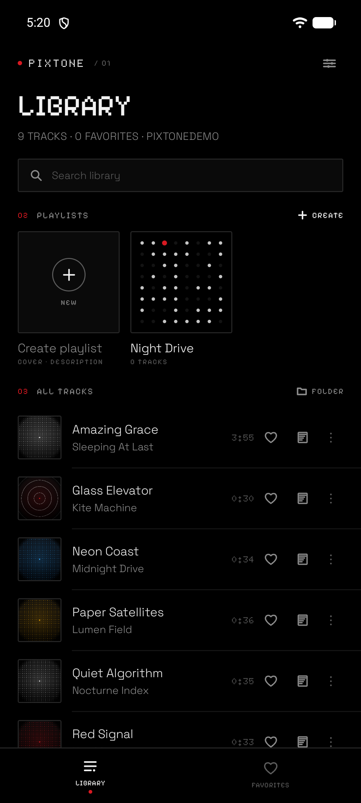
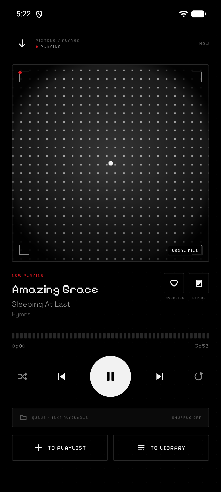
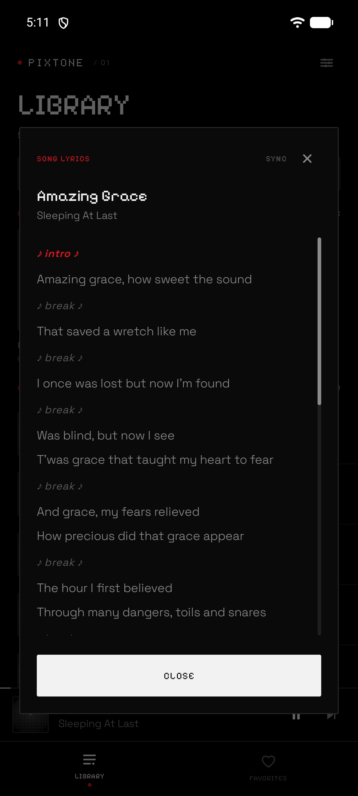
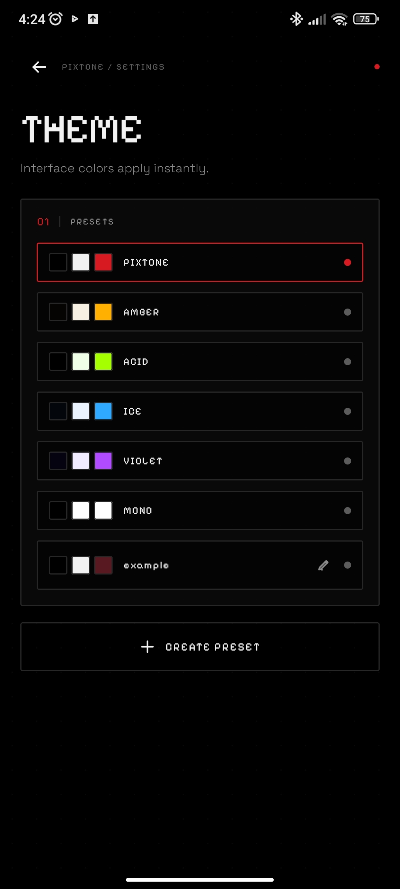
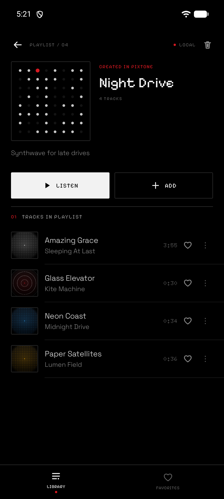
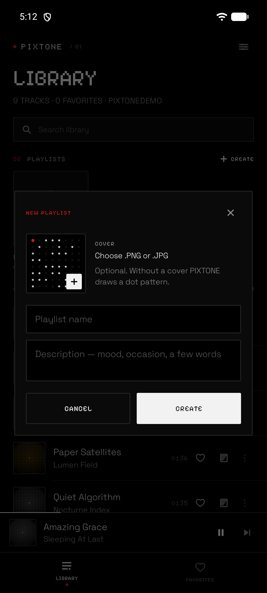

# PIXTONE

**A local-first music player for Android — quiet, sharp, and yours.**

PIXTONE plays the music stored on your device. No account, no cloud, no ads, no analytics. Just a folder, a queue and a interface built around dots, segments and pixels.


## Screenshots

| Library | Player |
|---|---|
|  |  |

| Lyrics | Themes |
|---|---|
|  |  |

| Playlist | Create playlist |
|---|---|
|  |  |

<details>
<summary>More screenshots</summary>

| Onboarding | Scanning |
|---|---|
|  |  |

| Settings | Add tracks |
|---|---|
|  |  |

| Fonts | Languages |
|---|---|
|  |  |

| Licenses |
|---|
|  |

</details>

> All screenshots show the English interface with a generated demo library. Track titles and cover art are original and created for this project; the lyrics shown are from the public-domain hymn "Amazing Grace".

## Features

- **Local-first library** — music is read through the Storage Access Framework; nothing is uploaded anywhere.
- **Folder scanning** — MP3, M4A, FLAC, WAV, OGG, OPUS and AAC with tags and embedded artwork.
- **Background playback** — Media3 ExoPlayer + MediaSession, notification controls, headset and Bluetooth support.
- **Sound tuning** — a panel in the player with equalizer presets and manual bands, bass boost, loudness enhancer, a built-in reverb and playback speed from 0.5× to 1.5× with the pitch following the speed.
- **Playlists and favorites** — fully offline, stored in a local SQLite database.
- **Artist search and manual track info** — search matches track titles, artists and albums; set or edit a title and artist for any track without touching the audio file.
- **Albums** — grouped automatically from file tags (album + artist), with a dedicated tab, album screen, multi-select removal from the app and per-album sorting. Audio files always stay on the device.
- **Sorting** — Sort tracks by title, date added, file modification date, album track number or playlist order; the library and playlist choices persist between launches.
- **Multi-select** — Long-press albums, tracks or playlists to select several at once, delete them in bulk and use the "select all" checkbox; search results are selected as a group.
- **Own images** — Pick a cover from the gallery for any track and add individual audio files without choosing a folder.
- **Sticky headers and collapsing search** — Section headers stay pinned while scrolling, and the search field folds away to give the list more room.
- **Lyrics** — search across LRCLIB, lyrics.ovh and Genius; plain and synced LRC with tap-to-seek. Select any lines to copy them or keep them as a quote for that track, then jump back to the moment a quote is sung.
- **Smart cover art** — Genius, Deezer and iTunes are queried in parallel; scraped covers are replaced with real ones.
- **Themes** — six built-in presets, a full custom palette editor (8 colors, RGB sliders and HEX input), saved custom presets with editing and deletion.
- **Custom typography** — three font roles (body, headings, accent) can use Doto, Pixelify Sans, Space Grotesk or the system font.
- **Six languages** — Russian, English, German, French, Chinese and Japanese, switchable at runtime. English is enabled by default.
- **Message queue with pixel dissolve** — every toast can be dismissed with a tap.
- **Lightweight** — no bundled media, artwork or tracking SDKs, so the app takes very little space and installs instantly.
- **No telemetry** — no trackers, no crash reporting, no third-party analytics SDKs.

## Tech stack

| Layer | Technology |
|---|---|
| Language | Kotlin 2.2 |
| UI | Jetpack Compose, Material 3, custom design system |
| Playback | AndroidX Media3 (ExoPlayer), MediaSessionService, system audio effects and a custom reverb AudioProcessor |
| Async | Kotlin Coroutines, StateFlow / SharedFlow |
| Images | Coil |
| Networking | OkHttp, org.json, Jsoup |
| Storage | SQLiteOpenHelper, SharedPreferences, Storage Access Framework |
| Architecture | Single-Activity, state-driven UI, ViewModel + repository layer, manual DI (`AppContainer`) |
| Build | Gradle 9.6, Android Gradle Plugin 9.4.1, JDK 21 |
| SDK | minSdk 26, targetSdk 37, compileSdk 37 |

## Architecture

```
MainActivity
  └── GlyphTheme (colors + typography from user settings)
        └── GlyphRoot (state-driven navigation)
              ├── LibraryScreen / FavoritesScreen
              ├── PlayerOverlay (with the sound panel)
              ├── SettingsScreen (theme, fonts, language, licenses)
              └── MessageHost (queued toasts)

MainViewModel ── MusicRepository ── GlyphDb (SQLite)
      │                ├── MusicScanner
      │                └── ArtworkStore
      ├── LyricsRepository ── LRCLIB / lyrics.ovh / Genius
      ├── CoverRepository  ── Genius / Deezer / iTunes
      └── PlayerConnection ── PlaybackService (Media3)
```

The app has no backend and no network dependency for playback. Network access is used only for optional lyrics and cover lookup.

## Project structure

```
app/src/main/java/com/vova/glyph/
├── MainActivity.kt          # single entry point
├── MainViewModel.kt         # app state and use cases
├── GlyphApp.kt              # application + container bootstrap
├── AppContainer.kt          # manual dependency injection
├── data/                    # database, scanner, repositories, prefs
├── playback/                # ExoPlayer connection and media session
├── i18n/                    # translations for six languages
└── ui/
    ├── GlyphRoot.kt         # root navigation and messages
    ├── theme/               # palette, presets, fonts, typography
    ├── components/          # design system and reusable UI
    └── screens/             # library, player, settings, onboarding
```

## Build

Requirements:

- JDK 21
- Android SDK with API 37
- Android Studio or the command line

```bash
git clone https://github.com/JameSanderlanding/PIXTONE.git
cd PIXTONE
./gradlew assembleDebug
```

The debug APK is produced at:

```
app/build/outputs/apk/debug/Pixtone-1.0.1.apk
```

`local.properties` with your own `sdk.dir` is ignored by Git.

## Branches

| Branch | Purpose |
|---|---|
| `mobile` | Default branch. The Android application. |
| `windows` | Placeholder for a future Windows port. |
| `linux` | Placeholder for a future Linux port. |

## Third-party licenses

Fonts — Doto, Pixelify Sans, Space Grotesk — are licensed under the **SIL Open Font License 1.1**.

Libraries are licensed under **Apache License 2.0** (AndroidX, Compose, Media3, Coil, OkHttp, Kotlin Coroutines) and **MIT** (Jsoup).

Full license texts are bundled in `app/src/main/assets/licenses/` and available inside the app under **Settings → Licenses**.

## Disclaimer

PIXTONE is a player for music you already own and is intended for **personal, non-commercial use only**. Track metadata, lyrics and cover art fetched from third-party services belong to their respective owners and are used only for local display. The project is not affiliated with any music service or brand.

## License

Released under the [MIT License](LICENSE).

---

Made by [JameSanderlanding](https://github.com/JameSanderlanding)

Special thanks to Angelina and Timofey
