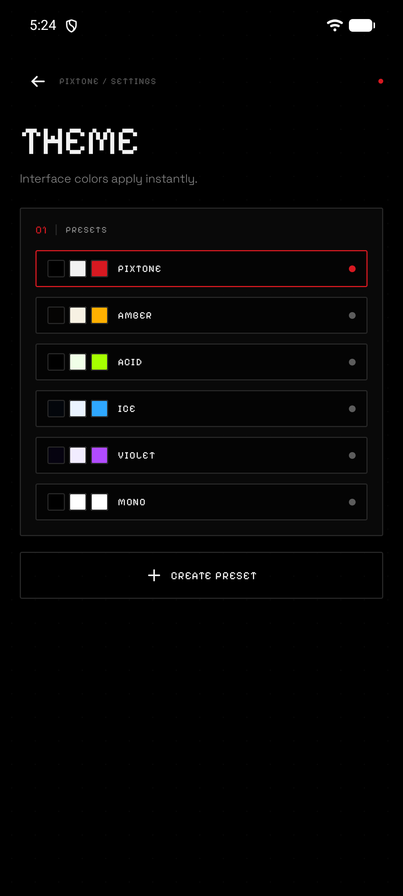

<div align="center">
  
</div>

<p align="center">
  
  
  
  
  
  
  
</p>

<p align="center">
  <b>A local-first music player for Android — quiet, sharp, and yours.</b><br>
  <sub>No account · no cloud · no ads · no analytics</sub>
</p>

PIXTONE plays the music stored on your device. Just a folder, a queue and an interface built around dots, segments and pixels. Nothing is uploaded anywhere: network access is used only for optional lyrics and cover lookup.

<p align="center">
  <code>52 KOTLIN FILES</code> · <code>13,149 LINES</code> · <code>6 LANGUAGES</code> · <code>0 TRACKERS</code> · <code>16.5 MB APK</code>
</p>

<p align="center">
  <a href="https://github.com/JameSanderlanding/PIXTONE/releases/latest"></a>
</p>

## 01 — Screenshots

All screenshots show the English interface with a generated demo library. Track titles and cover art are original and created for this project; the lyrics shown are from the public-domain hymn "Amazing Grace".

<table>
  <tr>
    <td align="center" width="33%">
      <br>
      <sub><b>01</b> · LIBRARY</sub>
    </td>
    <td align="center" width="33%">
      <br>
      <sub><b>02</b> · PLAYER</sub>
    </td>
    <td align="center" width="33%">
      <br>
      <sub><b>03</b> · LYRICS</sub>
    </td>
  </tr>
  <tr>
    <td align="center" width="33%">
      <br>
      <sub><b>04</b> · THEMES</sub>
    </td>
    <td align="center" width="33%">
      <br>
      <sub><b>05</b> · PLAYLIST</sub>
    </td>
    <td align="center" width="33%">
      <br>
      <sub><b>06</b> · CREATE PLAYLIST</sub>
    </td>
  </tr>
</table>

<details>
<summary>More screenshots</summary>

<br>

<table>
  <tr>
    <td align="center" width="33%">
      <br>
      <sub><b>07</b> · ONBOARDING</sub>
    </td>
    <td align="center" width="33%">
      <br>
      <sub><b>08</b> · SCANNING</sub>
    </td>
    <td align="center" width="33%">
      <br>
      <sub><b>09</b> · SETTINGS</sub>
    </td>
  </tr>
  <tr>
    <td align="center" width="33%">
      <br>
      <sub><b>10</b> · ADD TRACKS</sub>
    </td>
    <td align="center" width="33%">
      <br>
      <sub><b>11</b> · FONTS</sub>
    </td>
    <td align="center" width="33%">
      <br>
      <sub><b>12</b> · LANGUAGES</sub>
    </td>
  </tr>
  <tr>
    <td align="center" width="33%">
      <br>
      <sub><b>13</b> · LICENSES</sub>
    </td>
    <td align="center" width="33%"></td>
    <td align="center" width="33%"></td>
  </tr>
</table>

</details>

## 02 — Features

<table>
  <tr>
    <td align="left" valign="top" width="33%">
      <b>Local-first library</b><br>
      <sub>Music is read through the Storage Access Framework; nothing is uploaded anywhere.</sub>
    </td>
    <td align="left" valign="top" width="33%">
      <b>Folder scanning</b><br>
      <sub>MP3, M4A, FLAC, WAV, OGG, OPUS and AAC with tags and embedded artwork.</sub>
    </td>
    <td align="left" valign="top" width="33%">
      <b>Background playback</b><br>
      <sub>Media3 ExoPlayer + MediaSession, notification controls, headset and Bluetooth support.</sub>
    </td>
  </tr>
  <tr>
    <td align="left" valign="top" width="33%">
      <b>Sound tuning</b><br>
      <sub>Equalizer presets and manual bands, bass boost, loudness enhancer, built-in reverb and playback speed from 0.5× to 1.5× with the pitch following the speed.</sub>
    </td>
    <td align="left" valign="top" width="33%">
      <b>Playlists and favorites</b><br>
      <sub>Fully offline, stored in a local SQLite database.</sub>
    </td>
    <td align="left" valign="top" width="33%">
      <b>Artist search and manual track info</b><br>
      <sub>Search matches titles, artists and albums; edit a title or artist without touching the audio file.</sub>
    </td>
  </tr>
  <tr>
    <td align="left" valign="top" width="33%">
      <b>Albums</b><br>
      <sub>Grouped automatically from tags (album + artist), with a dedicated tab, album screen and per-album sorting.</sub>
    </td>
    <td align="left" valign="top" width="33%">
      <b>Sorting</b><br>
      <sub>By title, date added, file modification date, album track number or playlist order; library and playlist choices persist between launches.</sub>
    </td>
    <td align="left" valign="top" width="33%">
      <b>Multi-select</b><br>
      <sub>Long-press albums, tracks or playlists to select several at once, delete them in bulk and use the "select all" checkbox.</sub>
    </td>
  </tr>
  <tr>
    <td align="left" valign="top" width="33%">
      <b>Own images</b><br>
      <sub>Pick a cover from the gallery for any track and add individual audio files without choosing a folder.</sub>
    </td>
    <td align="left" valign="top" width="33%">
      <b>Sticky headers and collapsing search</b><br>
      <sub>Section headers stay pinned while scrolling, and the search field folds away to give the list more room.</sub>
    </td>
    <td align="left" valign="top" width="33%">
      <b>Lyrics</b><br>
      <sub>Search across LRCLIB, lyrics.ovh and Genius; plain and synced LRC with tap-to-seek. Select any lines to copy them or keep them as a quote, then jump back to the moment a quote is sung.</sub>
    </td>
  </tr>
  <tr>
    <td align="left" valign="top" width="33%">
      <b>Smart cover art</b><br>
      <sub>Genius, Deezer and iTunes are queried in parallel; scraped covers are replaced with real ones.</sub>
    </td>
    <td align="left" valign="top" width="33%">
      <b>Themes</b><br>
      <sub>Six built-in presets and a full custom palette editor (8 colors, RGB sliders and HEX input), with saved custom presets that can be edited and deleted.</sub>
    </td>
    <td align="left" valign="top" width="33%">
      <b>Custom typography</b><br>
      <sub>Three font roles (body, headings, accent) can use Doto, Pixelify Sans, Space Grotesk or the system font.</sub>
    </td>
  </tr>
  <tr>
    <td align="left" valign="top" width="33%">
      <b>Six languages</b><br>
      <sub>Russian, English, German, French, Chinese and Japanese, switchable at runtime. English is enabled by default.</sub>
    </td>
    <td align="left" valign="top" width="33%">
      <b>Message queue with pixel dissolve</b><br>
      <sub>Every toast can be dismissed with a tap.</sub>
    </td>
    <td align="left" valign="top" width="33%">
      <b>Lightweight and private</b><br>
      <sub>No bundled media, artwork or tracking SDKs, so the APK stays at 16.5 MB. No trackers, crash reporting or analytics.</sub>
    </td>
  </tr>
</table>

## 03 — Tech stack

| Layer | Technology |
|---|---|
| **Language** | Kotlin 2.2 |
| **UI** | Jetpack Compose, Material 3, custom design system |
| **Playback** | AndroidX Media3 (ExoPlayer), MediaSessionService, system audio effects and a custom reverb AudioProcessor |
| **Async** | Kotlin Coroutines, StateFlow / SharedFlow |
| **Images** | Coil |
| **Networking** | OkHttp, org.json, Jsoup |
| **Storage** | SQLiteOpenHelper, SharedPreferences, Storage Access Framework |
| **Architecture** | Single-Activity, state-driven UI, ViewModel + repository layer, manual DI (`AppContainer`) |
| **Build** | Gradle 9.6, Android Gradle Plugin 9.4.1, JDK 21 |
| **SDK** | minSdk 26, targetSdk 37, compileSdk 37 |

## 04 — Architecture

```text
MainActivity
  └── GlyphTheme (colors + typography from user settings)
        └── GlyphRoot (state-driven navigation)
              ├── LibraryScreen / FavoritesScreen
              ├── PlayerOverlay (with the sound panel)
              ├── SettingsScreen (theme, fonts, language, licenses)
              └── MessageHost (queued toasts)

MainViewModel ── MusicRepository ── GlyphDb (SQLite)
      ├── MusicScanner / ArtworkStore
      ├── LyricsRepository ── LRCLIB / lyrics.ovh / Genius
      ├── CoverRepository  ── Genius / Deezer / iTunes
      └── PlayerConnection ── PlaybackService (Media3)
```

The app has no backend and no network dependency for playback. Network access is used only for optional lyrics and cover lookup.

## 05 — Project structure

```text
app/src/main/java/com/vova/glyph/
├── MainActivity.kt          # single entry point
├── MainViewModel.kt         # app state and use cases
├── GlyphApp.kt              # application + container bootstrap
├── AppContainer.kt          # manual dependency injection
├── data/                    # database, scanner, repositories, prefs
├── playback/                # ExoPlayer connection and media session
├── i18n/                    # translations for six languages
└── ui/
    ├── GlyphRoot.kt         # root navigation and messages
    ├── theme/               # palette, presets, fonts, typography
    ├── components/          # design system and reusable UI
    └── screens/             # library, player, settings, onboarding
```

## 06 — Build

Requirements:

- JDK 21
- Android SDK with API 37
- Android Studio or the command line

```bash
git clone https://github.com/JameSanderlanding/PIXTONE.git
cd PIXTONE
./gradlew assembleDebug
```

The debug APK is produced at:

```text
app/build/outputs/apk/debug/Pixtone-1.1.0.apk
```

`local.properties` with your own `sdk.dir` is ignored by Git.

## 07 — Branches

| Branch | Purpose |
|---|---|
| `mobile` | Default branch. The Android application. |
| `windows` | Placeholder for a future Windows port. |
| `linux` | Placeholder for a future Linux port. |

## 08 — Third-party licenses

Fonts — Doto, Pixelify Sans, Space Grotesk — are licensed under the **SIL Open Font License 1.1**.

Libraries are licensed under **Apache License 2.0** (AndroidX, Compose, Media3, Coil, OkHttp, Kotlin Coroutines) and **MIT** (Jsoup).

Full license texts are bundled in `app/src/main/assets/licenses/` and available inside the app under **Settings → Licenses**.

## 09 — Disclaimer

PIXTONE is a player for music you already own and is intended for **personal, non-commercial use only**. Track metadata, lyrics and cover art fetched from third-party services belong to their respective owners and are used only for local display. The project is not affiliated with any music service or brand.

## 10 — License

Released under the [MIT License](LICENSE).

---

<p align="center">
  <sub>Made by <a href="https://github.com/JameSanderlanding">JameSanderlanding</a></sub><br>
  <sub>Special thanks to Angelina and Timofey</sub>
</p>
